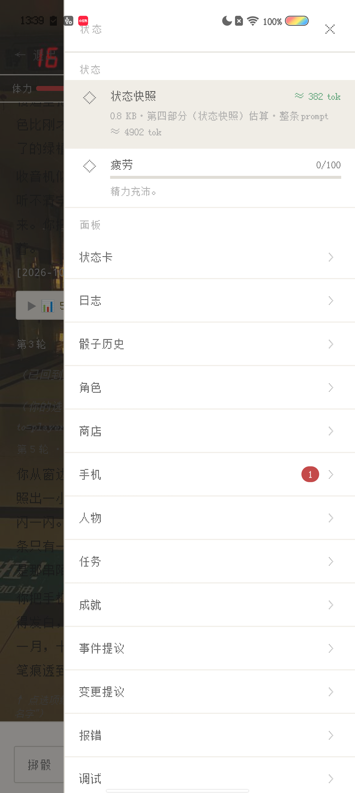
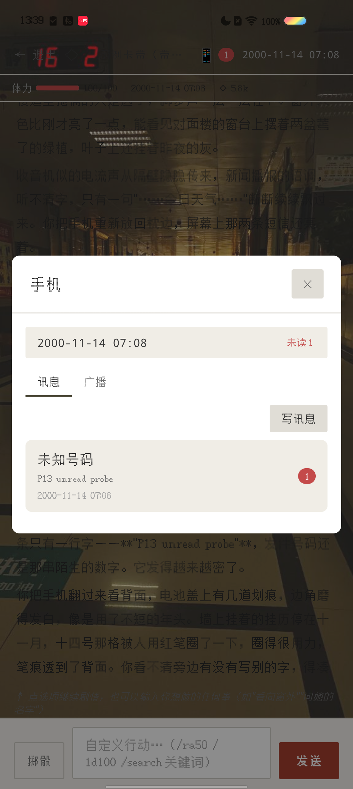
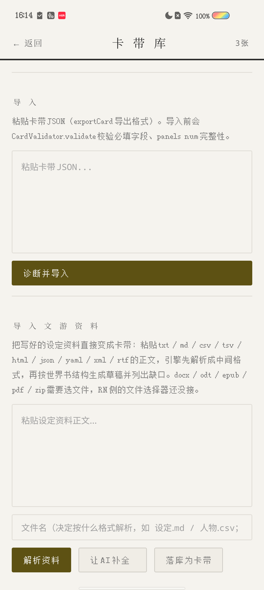
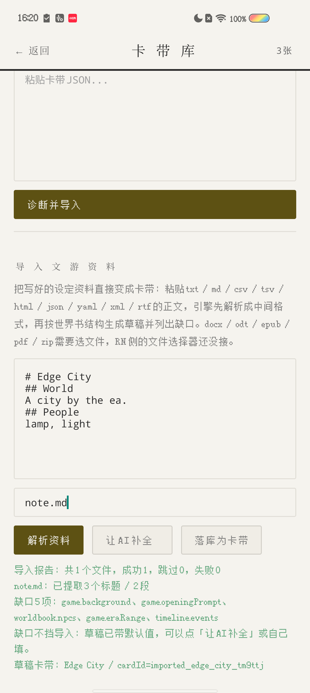

# 神秘小引擎（Hippocampus）

**手机上就能玩的 AI 文字冒险。AI 当主持人，剧情当场编，存档只留在你自己手机里。**

不用注册、不用买服务器、不用等别人开服。你给它一个世界（我们叫「卡带」），它让 AI 当主持人陪你往下玩：写正文、演 NPC、改数值、管时间，还会在剧情之外给你发短信。

> 版本：1.3.5 ｜ Android 7.0+ ｜ 另有 Windows 桌面版 ｜ MIT 许可
> 项目现状：40 套 RN smoke 共 2625 条断言全绿；桌面版另有 14 项预检 + 98 套回归（2026-10-23 角色档案批后重记：新增 test_p76_character_sheet.js）。

**目录**：[最近更新](#最近更新2026-10-21) ｜ [它长什么样](#它长什么样) ｜ [先认识几个词](#先认识几个词) ｜ [三分钟开始玩](#三分钟开始玩) ｜ [首页六个入口](#第一次打开六个入口分别是什么) ｜ [卡带是什么](#卡带是什么) ｜ [自己造卡带](#我不会写设定也想玩自己的世界) ｜ [功能一览](#玩起来有什么) ｜ [常见问题](#常见问题) ｜ [已知限制](#已知限制先说清楚免得到了那一步才发现) ｜ [改代码](#想自己改代码--自己打包)

---

## 最近更新（2026-10-21）

这一版主要解决两件一直让人别扭的事：**回退会把内容吞掉**，和 **AI 老爱替玩家做决定**。

- **回退与分支**：每轮右侧的「↩ 回到这里」不再删掉后面的剧情，而是切成一条旧分支（想回来随时能切回原来的分支）；「重新生成」同样保留旧版本。轮号现在只增不减，历史日志也不物理删除了，改成归档，日志面板里可以「显示已归档」再恢复。开场那一轮现在也能回退（「开场 · ↩ 回到开头」）。
- **叙事检查（反说教 / 反替玩家操作）**：引擎新增五条确定性检查——替玩家做决定或写内心、心理诊断式说教、口头宣布关系跃迁却没有工具凭证、没演过的关系突跳、以及 NPC 说话风格跑偏。命中后默认**只在叙事末尾提示一句**（`设置 → 通用 → 文风闸门`），不会偷改你的正文；开成「自动重写」也只会重写越界的那一小段。
- **互动类型识别**：引擎先判断你这句话是闲聊 / 交易 / 冲突 / 关心 / 试探 / 事件，只有真需要的时候才给 AI 加一行约束。**闲聊轮一个字都不加**，所以普通对话的 token 成本和以前一样，也更不容易被 AI 当成"求生援助"来演。
- **长程记忆与文风**：设置里能填「剧情要点 / 前情摘要 / 文风要求」三块，可让引擎每 8 轮自动生成一次摘要；五个文风预设（冷峻克制 / 古典白描 / 黑色幽默 / 快节奏短句 / 日系轻小说）。
- **卡带侧**：`worldbook.timeline`（`official` 原作事实 / `fanFuture` 同人默认走向）、`worldbook.lore`（关键词触发的设定条目，提到才注入）、NPC `voice`（口吻参考）都已写进「生成卡带指令」模板。
- 这一版在 Android 14 真机和 x86_64 模拟器上都跑过主路径（建角 → 叙事 → 侧栏 → 回退 → 设置 → 卡带库），并把一个只有真机才会暴露的引擎 bug（叙事检查在 Hermes 下静默不执行）修掉了。

---

## 它长什么样

打开一局，屏幕大概是这样（示意，实际排版见下方截图墙）：

```
┌──────────────────────────────┐
│ 体力 78/100   声望 12   第 3 轮 │  ← 顶栏：数值 + 当前回合
├──────────────────────────────┤
│ 雨敲在铁皮棚上。你把灯罩按低，   │
│ 桌上那封电报只剩一行字：        │  ← AI 写的正文（流式吐字）
│ 「货在北仓，子时。」             │
│                              │
│ （体力 −2 ｜ 线索 +1：北仓）    │  ← 数值变了几点，这里会标出来
├──────────────────────────────┤
│ ① 立刻去北仓                    │
│ ② 先查电报落款                  │  ← 每轮给你的选项
│ ③ 自己行动…                     │
└──────────────────────────────┘
```

你要做的就三件事：**看正文 → 点一个选项（或自己打字）→ 等下一轮**。中间所有记账（掉了多少血、谁在场、现在几点、哪条线索已经拿到）都由引擎替你做，你不用管。

---

## 先认识几个词

这几个词后面会一直出现，两分钟就能记住：

| 词 | 一句话解释 |
|---|---|
| **卡带** | 一个世界。世界观、NPC、职业、技能、物品、商店、势力、结局……全都写在一份 JSON 里。换卡带 = 换个世界玩，存档各自独立。 |
| **主持人** | 就是 AI。它不直接改你的存档，只能提出「把体力减 2」「把这条线索记下来」这样的申请，引擎查过没问题才真的落地。所以它不容易把局面搞崩。 |
| **世界书** | 卡带里那一大堆设定资料。AI 每轮只看到跟当前场景相关的几条（省 token、也不容易串戏），不是每次都把整本书塞给它。 |
| **回合** | 一次「AI 写正文 → 你选择/行动」。存档里记的就是第几回合。 |
| **手机讯息** | AI 在正文之外发给你的短信 / 广播，带未读红点。想忽略就忽略，想当线索也行。 |
| **工具调用** | AI 每次想改世界时发的「申请单」。掉血、加物品、解锁地点、触发结局，全走这套流程。 |

---

## 三分钟开始玩

### 第 1 步：装到手机上

👉 **[下载最新 APK](https://github.com/AngryandfightingagainstAI/Hippocampus-core/releases/latest)**

在 Release 页面点最新那条，下载 `.apk`，点开安装。

- 第一次装会提示「未知来源应用」，允许一次即可；
- 国产 ROM 常有「安全守护」拦截页，勾上「已了解应用的风险检测结果」再点「继续安装」；
- 每个 Release 都写了版本号与 SHA256，介意可以自己核对。

### 第 2 步：打开，直接开玩

首屏自带一张「示例卡带」，点 **02 新建存档** 就能进游戏，什么都不用准备。

### 第 3 步：接上 AI

不接 AI 也能点开看界面，但正文写不出来。**设置 → 🤖 AI** 里有两条路，选一条：

**A. 有 API Key（一键直达，推荐）**

填三样东西：Base URL、模型名、Key。OpenAI、DeepSeek、通义千问、Kimi、智谱、Gemini、Groq、各种中转站、本机 Ollama 都能用——只要对方兼容 OpenAI 的接口格式即可。填完点「测试连接」，绿灯就能玩。

**B. 没有 Key、也不想花钱（外部 AI 通道）**

把「对话通道」切成 **外部 AI（手动复制 → 粘贴）**。这种模式下 App **完全不联网**，流程是：

1. 你点「继续」，App 把这一轮的提示词（含你的选择、当前局面）复制到剪贴板；
2. 你把它粘到任意一个网页版 AI（ChatGPT / DeepSeek / 豆包 / Kimi 都行）里；
3. 把 AI 的回复整段复制回来；
4. 粘进 App 的输入框，点提交；
5. 引擎照常解析、改数值、出下一轮选项。

多两步操作，但一分钱不花，Key 也不用填进来。

---

## 第一次打开，六个入口分别是什么

首页那六行，从上到下：

| 入口 | 干什么 |
|---|---|
| **01 继续上次会话** | 读这张卡带最近一次存档。没有存档时是灰的（「暂无存档」）。 |
| **02 新建存档** | 按这张卡带的开局流程创角（姓名、性别、时代，或卡带作者自己设计的问卷），然后进第 1 回合。 |
| **03 换一张卡带** | 库里有几张就列几张，点一张就切成当前卡带（当前卡的首页书票、存档都会跟着换）。 |
| **04 管理卡带与导入** | 卡带库：导入 JSON、导入文档资料、**生成卡带指令**、导出、删除、设为当前卡。卡带相关的活都在这。 |
| **05 存档管理** | 所有存档（跨卡带），可以改名、删除、导出。 |
| **06 设置** | AI 通道、字号、主题、数据备份与恢复、数值编辑器、GM 设定等。 |

首页下半部分还有两块：**目录·存档**（这张卡带有哪些存档，点一条直接续玩）和**书票·主题**（这张卡带的封面样式，见下方「已知限制」里的说明）。

顶部三个页签是 **主页 / 叙事 / 设置**；**叙事**页就是正文 + 选项那一屏，左侧滑出的是**侧栏面板**。

---

## 叙事页和侧栏面板

叙事页上除了正文和选项，还有几个按钮：

- **重新生成**：这一轮不满意，让它把这轮重写一遍（也重新走一遍工具与校验：改动会重新记，不是简单换段文字）；
- **回到这里**：退回到某一轮重玩，后面的内容丢掉（点之前会先问你一次）；
- **思考链**：展开能看到模型的推理过程、联网搜索结果、token 用量，三块都能各自关掉。

从左侧滑出（或点侧栏按钮）是一排面板，卡带开了哪个就显示哪个：

| 面板 | 看什么 |
|---|---|
| 角色卡 | 属性、名声、关系、物品、世界书命中项，一屏看完 |
| 状态卡 | 卡带作者定制的动态字段（体力、理智、饥饿…） |
| 日志 | 这一局的行动流水，按回合排 |
| 骰子历史 | 掷过哪些骰、结果多少 |
| 手机讯息 | 剧情之外的短信/广播 |
| NPC | 见过谁、关系怎么样、谁的秘密还没揭开 |
| 商店 | 卡带里的买卖，钱够不够当场算 |
| 任务 / 成就 / 结局 | 进度、达成了什么、有哪些结局还没解锁 |
| 故事节点 / 产出物 | 主线走到哪、拿到了什么物件 |
| 事件提议 / 改动提议 | AI 想在后面几轮埋的伏笔，以及它申请的世界改动（可以不放行） |
| 错误日志 / 调试 | 出问题时看的地方，报错建议 Ctrl+C 复制整份发出来 |

---

## 卡带是什么

一张卡带就是**一份 JSON**。最小能玩的样子长这样（下面这段可以直接粘进「卡带库 → 粘贴卡带 JSON」试）：

```jsonc
{
  "schemaVersion": "1.2",              // 版本号，照抄
  "cardId": "my_first_world",          // 唯一 ID，英文小写
  "cardName": "我的第一个世界",         // 名字，卡带库里显示这个
  "description": "一句话介绍",
  "game": {                            // 故事的基本信息
    "title": "雾港疑案",
    "background": "1920 年代的港口城市，雨一直没停。"
  },
  "hud": [                             // 顶栏数值
    { "key": "hp", "name": "体力", "icon": "heart", "max": 100, "init": 100 }
  ],
  "sidebar": [                         // 侧栏里的辅助数值，可带分段描述
    { "key": "sanity", "name": "理智", "icon": "moon", "max": 100, "init": 80,
      "segments": [ { "min": 0, "max": 30, "text": "你在崩溃边缘。" },
                    { "min": 31, "max": 100, "text": "还算清醒。" } ] }
  ],
  "panels": [                          // 面板：num 2/3/4/5 必须齐（详情见下）
    { "id": "clues", "num": 2, "name": "线索", "entries": [] },
    { "id": "people", "num": 3, "name": "人物", "entries": [] },
    { "id": "places", "num": 4, "name": "地点", "entries": [] },
    { "id": "items", "num": 5, "name": "行装", "entries": [] }
  ],
  "attributes": [                      // 创角时分配的属性
    { "key": "perception", "name": "观察", "icon": "eye", "min": 5, "max": 20, "init": 10 }
  ],
  "steps": [                           // 可选：开局创角流程
    { "id": "name", "type": "form", "title": "你是谁",
      "fields": [ { "key": "name", "type": "text", "label": "姓名", "required": true } ] }
  ]
}
```

必填的就八个：`schemaVersion`、`cardId`、`cardName`、`game`（里面 `title` 不能空）、`hud`、`sidebar`、`panels`、`attributes`。其余字段（世界书、NPC、技能、物品、商店、势力、地图、时间线、结局、成就、任务、问卷…）都是可选的，写了就会出现在游戏里，不写也不会报错。

两个容易踩的坑：

- `panels` 里 `num` **2、3、4、5 必须齐**（1 可省），少一个导入时就会提示「panels 缺少 num=N」——这是引擎按编号排面板的顺序，不齐会乱序。
- `panels[].entries` 里的条目要写 `type`（`number` / `relation` / `list` / `switch`）和 `key`，没有条目就给空数组 `[]`。

`icon` 统一填 [Feather](https://feathericons.com) 的图标名（`heart` / `moon` / `map-pin` / `users` / `shield`）或单个 emoji，两种运行时时都支持。

---

## 我不会写设定，也想玩自己的世界

三条路，都不用会写代码：

**① 让 AI 替你写（最省事）**

打开 **卡带库 → 生成卡带指令**，里面是 6 段提示词：

| 段 | 内容 |
|---|---|
| 1 · 基础骨架 | **必给**。schema 全字段 + 硬性要求，AI 照着填就有一张能跑的卡带 |
| 2 · 事件系统 | 剧情事件、伏笔、多结局的门槛怎么设计 |
| 3 · NPC 规范 | NPC 的关系、秘密、台词风格、更新时机 |
| 4 · 内容要求 | 文风、用词、每轮的字数、别写「你成功了」这种空话 |
| 5 · 可选系统 | 商店、任务、成就、状态卡、日历这些加料模块 |
| 6 · 世界书数据 | 一次灌大量设定的写法（地名、势力、年表） |

第 1 段复制给你的 AI（ChatGPT / DeepSeek / Claude / 豆包都行），它吐出 JSON，粘回 App 导入即可。想更细就把 2–6 段按需追加。

**② 把现成的资料丢进去**

**卡带库 → 导入文游资料**：txt / md / csv / tsv / html / json / yaml / xml / rtf 直接粘；docx / odt / epub / pdf / zip 点「选择文件…」从手机里挑。引擎会先把它解析成「卡带草稿」，列出还缺什么，再让 AI 补——你不用一次写完。

**③ 粘回来导入**

拿到 JSON 后粘进「粘贴卡带 JSON」框，点 **诊断并导入**。导入前它会体检：缺哪个字段、哪个面板编号重了、哪条引用断了，都会明确告诉你——**有问题不硬塞，先修再进**。

---

## 玩起来有什么

| 你会用到的 | 说明 |
|---|---|
| 叙事 | 流式吐字、选项按钮 + 自定义行动、重新生成、回到某一轮 |
| 思考链 | 推理过程 / 联网搜索 / token 用量，三块独立开关 |
| 骰子 | `1d100`、对抗检定、`/ra50` 简写，历史可查；结果会真的影响判定 |
| 手机讯息 | 剧情之外的短信与广播，有未读红点；要不要进正文由你决定 |
| 数值系统 | 顶栏数值、侧栏数值、分段描述、属性分配、数值编辑器手动微调 |
| 角色与世界 | 角色卡、NPC 关系、世界书命中项、12 个世界书子编辑器 |
| 元层 | 任务、成就、结局（带触发门槛）、产出物、AI 提议的伏笔与改动 |
| 主题与书票 | 纸白 / 流光 / 古卷三套内置主题，能导入别人做的主题包；书票还能自定义印章与身份色 |
| 存档 | 随时存、随时读、多存档并行；数据页可整包导出/导入 |
| 两条 AI 通道 | 直连 API，或「手动复制→粘贴」的零成本模式 |

---

## 常见问题

**要不要花钱？**
软件本身免费开源（MIT）。AI 的钱是付给模型商的，按你自己的用量算。
一分钱都不想花也能玩：用「外部 AI」通道，回复自己粘回来，App 这边不产生任何网络请求。

**存档在哪？会被上传吗？**
在手机本地数据库里，不上传、没有账号、没有遥测。卸载或清数据会一起删掉；要留就在 **设置 → 数据** 里导出备份。

**换手机怎么搬？**
设置 → 数据 → 导出整包，把 JSON 文件传到新手机再导入。注意：**带 API Key 导出时它会问你一次**——选「不含 Key」的版本更安全。

**AI 会不会玩着玩着忘掉前面？**
每回合引擎都重新拼一份「当前状态」给 AI（数值、在场 NPC、时间、未读讯息、最近发生的事），历史太长时会把旧对话压成日志。所以它比普通 AI 聊天抗忘，但长局依然会有偏差，这不是彻底解决方案。

**AI 会不会乱改我的数值？**
所有世界改动只能通过工具调用完成，引擎会校验。而且如果某一轮工具全部失败却动了数值，引擎会自动回滚并让它重来。

**能联机 / 多人吗？**
不能。单人、纯本地。

**支持 iPhone 吗？**
暂不支持。目前只做了 Android，`ios/` 还是模板脚手架。

**我没电脑，能自己加卡带吗？**
能。手机上就能导入 JSON，也能用「导入文游资料」吃文档。只有打包 APK、改代码才需要电脑。

**能边玩边改卡带吗？**
可以改设置和主题，但改卡带内容（世界书那些）需要重新导入。涉及世界书的切换会提示你保存。

---

## 想自己改代码 / 自己打包

开发环境、打包、签名口径、跑测试、两仓同源机制、项目结构都在 **[docs/DEVELOPING.md](docs/DEVELOPING.md)**。

一句话版：`npm install` → `npm start` + `npm run android` 跑起来；`cd android && ./gradlew assembleRelease` 出包；`node tools/run_all_smokes.js` 跑全部测试。

<details>
<summary>自动化覆盖的现状（给要改代码的人看）</summary>

创角流程、结局触发、元层提议都有自动化覆盖（`tools/create_flow_smoke.js` 120 条、`tools/endings_gate_smoke.js` 27 条、`tools/proposal_audit_smoke.js` 19 条），但真机人工验证仍是主要手段。

两仓同在本机时跑出 40 套 / 2625 ok；**单仓**环境（CI 里看不到桌面仓）下，跨仓同源断言自动降级为 SKIP：`2615 ok / 0 failed / TOTAL_SKIP=20`。降级只影响「另一仓是否可见」这类断言，不影响产品行为。

</details>

---

## 已知限制（先说清楚，免得到了那一步才发现）

- **只有 Android**：iOS 一侧没做（原生模块只写了 Android，`ios/` 是模板脚手架）。
- **手机版导入大文件要注意**：文本类可以粘贴或选文件；docx / odt / epub / PDF / ZIP 在手机上解析会慢，建议桌面版导入后再导出卡带。
- **手机讯息是概率性的**：有冷却与概率，连着几轮没收到短信是正常的，只有第一条保证送达。
- **农历节日不做**：每年日期不同，引擎暂不支持。
- **设置页切换不拦**：只有涉及世界书的切换会提示保存，其它页即时生效。
- **主页装扮跟卡带走，不跟全局主题走**：首页的书票样式（纸白 / 流光 / 古卷）由这张卡带的 `display` 决定，也可以在首页临时切换；你在「设置 → 主题」里选的主题影响的是其它页面。这是有意为之——换卡带时封面跟着换。

---

## 致谢与许可

- 引擎、桥接层与 UI 壳为本项目自研。
- 运行时依赖：React Native、`@op-engineering/op-sqlite`、`react-native-mmkv`、`react-native-image-picker`、`react-native-safe-area-context`。
- 本项目以 **MIT** 许可发布，全文见仓内 [`LICENSE`](LICENSE)。卡带素材（若有）请以各素材来源的授权为准。

---

## 截图

| 叙事页 | 侧栏（角色卡） |
|---|---|
|  |  |

| 手机讯息面板 | 关掉再打开还能接着玩 |
|---|---|
|  |  |

| 导入卡带 | 导入后先给你一份体检报告 |
|---|---|
|  |  |
